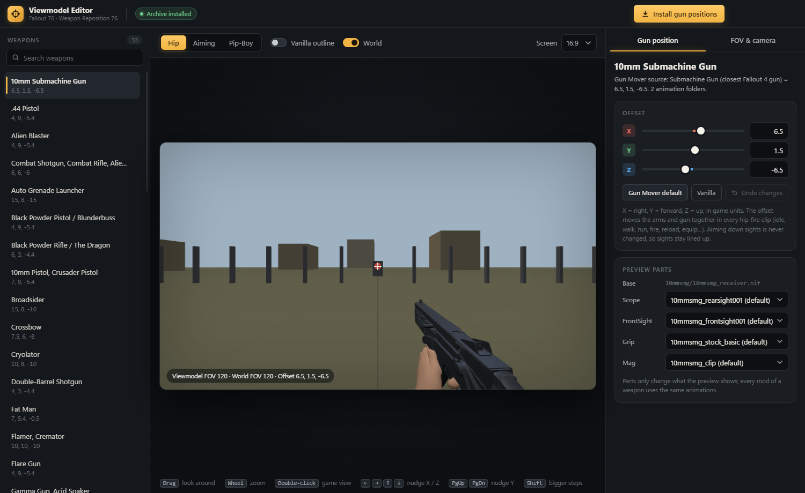
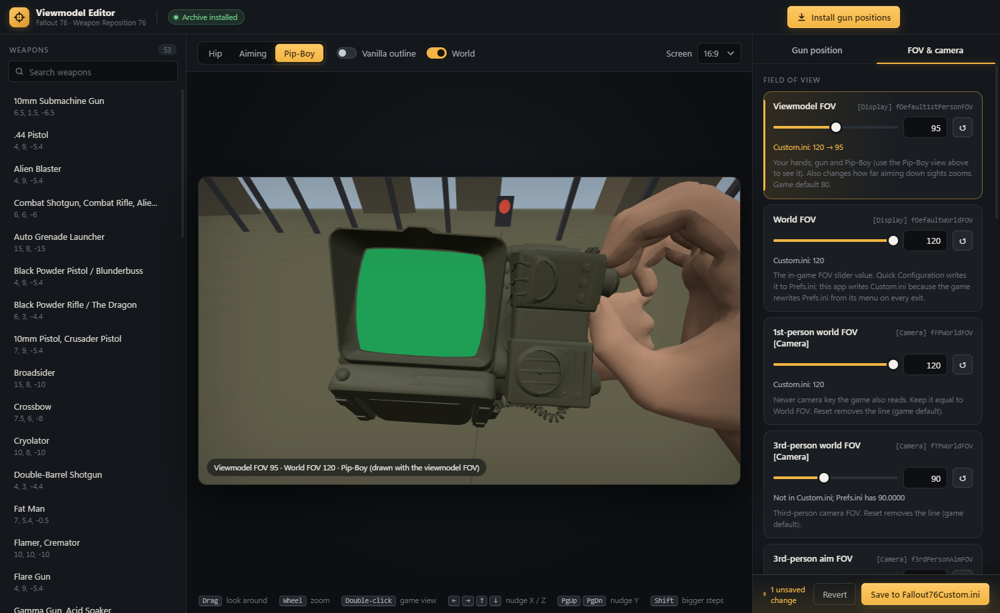

# FO76 Viewmodel Editor

A Windows desktop app for **Fallout 76** that sets where every gun sits on screen, with a live 3D preview
built from your own game files, plus the viewmodel / FOV / camera ini settings that Quick Configuration
exposes. It bakes your gun positions into the animations and writes the **Weapon Reposition 76** archive
for you.





## What it does

- **Per-weapon gun positions.** 53 weapon groups with X / Y / Z sliders, Gun Mover defaults, vanilla, and undo.
  An offset is baked into the COM track of every hip-fire first-person clip (idle, walk, run, fire, reload,
  equip…). Aim-down-sights clips are left alone, so sights stay lined up.
- **3D preview from the game's own files.** The app reads the game's BA2 archives directly, poses the
  first-person skeleton from the weapon's idle clip, skins the hands, and assembles the weapon from its
  NIF parts through their connect points. World and viewmodel are drawn in two passes with their own FOV,
  like the game. Checked against in-game screenshots: the ini FOV is the horizontal FOV of a 16:9 screen.
- **Pip-Boy preview.** The Pip-Boy drawn with the viewmodel FOV, the way the game draws it. Fallout 76 has
  no separate Pip-Boy FOV setting.
- **FOV & camera settings.** Viewmodel FOV, world FOV, the `[Camera]` FOVs, 3rd-person aim FOV and the
  over-the-shoulder camera, with live preview. Writes `Fallout76Custom.ini` (`Project76Custom.ini` on
  Game Pass) and keeps line endings, comments and order.
- **One-click install.** Rebuilds the archive (about a minute), checks every clip, backs up the old
  archive, and adds it to `sResourceArchive2List` if it isn't listed.
- **Finds the game itself.** Looks in Steam libraries (`libraryfolders.vdf`), Microsoft Store / Game Pass
  and old Bethesda.net installs, and asks for the folder if none is found.

## How it's built

| Part | Tech |
| --- | --- |
| UI | Electron 33, plain HTML/CSS/JS, three.js 0.170 for the preview |
| Backend | Python 3.13 (standard library only), JSON lines over stdin/stdout |
| Game data | Custom readers/writers for BA2 (BTDX v1 GNRL), NIF (BSTriShape, skin, connect points) and Havok `.hkx` animations |

```
main.js            Electron main process: backend process, ini edits, state, install, window
game.js            finding the Fallout 76 install and which ini names it uses
ini.js             minimal ini get/set that leaves every other line untouched
preload.js         the renderer's API (contextIsolation + sandbox)
renderer/          UI and three.js preview
backend/server.py  request loop
backend/vmcore.py  preview scenes (rig, skinning, weapon assembly, Pip-Boy) and the archive build
backend/ba2.py     archive index / reader
backend/weapons.py preview mesh + default parts per weapon group
backend/tools/     Weapon Reposition 76 tools: animation offset, verification, BA2 writer, NIF reader, Gun Mover table
pack.ps1           builds the portable Nexus version (renamed Electron + bundled Python)
```

## Running from source

Requires Windows, Node.js, Python 3.13 (in `%LOCALAPPDATA%\Programs\Python\Python313` or on `PATH`) and
Fallout 76.

```bash
npm install
npm start
```

When the app folder sits at `<game>\Mods\_viewmodel_editor` it uses that game install; otherwise it finds
the game as described above.

## Building the portable version

```bash
powershell -ExecutionPolicy Bypass -File pack.ps1
```

This writes `dist\FO76 Viewmodel Editor\`: a renamed Electron runtime with the app, the backend, and a
trimmed copy of the local Python 3.13 (standard library zipped, embeddable-style `._pth`). Nothing is
downloaded. The packaged app keeps settings, cache and backups in `%APPDATA%\FO76 Viewmodel Editor`.

## Credits

- [Gun Mover](https://www.nexusmods.com/fallout4/mods/92454) by jarari (Fallout 4): the original mod,
  ported with the author's permission.
- [First Person FOV Overhaul](https://www.nexusmods.com/fallout4/mods/105685) by HumanKvas (Fallout 4):
  the per-weapon offsets.
- Fallout 76 Quick Configuration: the idea for the FOV page.
- Bethesda Game Studios: Fallout 76. No game files are included; the app reads them from your install.
